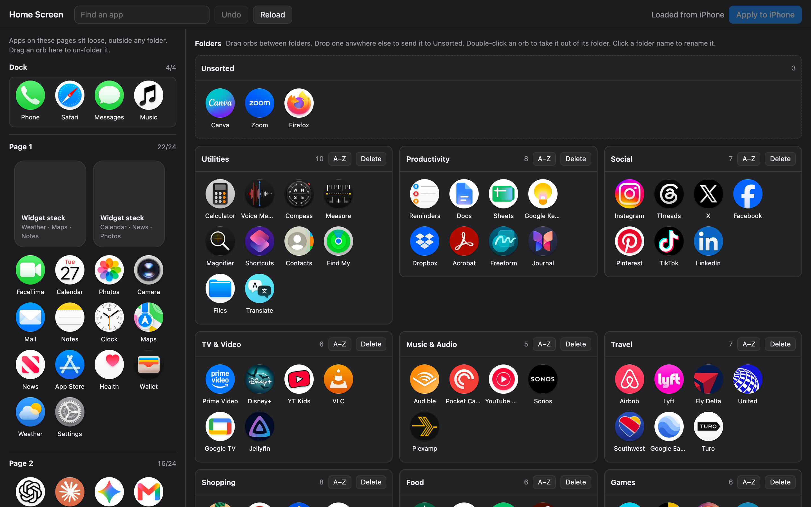

# iPhone Home Screen Editor

Rearrange your iPhone's home screen from your computer by dragging app icons around in a browser, then push the result to the phone over USB.



- Every app shows up as a draggable orb with its real icon, pulled from the phone.
- The dock and each home screen page are listed on the left; every folder is shown open on the right.
- Drag apps between pages and folders, rename, sort or delete folders, and create new ones.
- An **Unsorted** tray holds apps you haven't decided on. Drop an app anywhere that isn't a page or folder and it lands there.
- Nothing touches the phone until you click **Apply to iPhone**, and every apply saves a backup of the previous layout first.

No jailbreak and no app on the phone. It talks to the phone's SpringBoard service over USB, the same one old versions of iTunes used to arrange home screens.

## Why I made this

I recently switched from Android to iPhone. The migration brought over a ton of apps from my Android phone, many of which I hadn't touched in years. They'd just piggybacked across every Android upgrade I'd ever made.

That was fine on Android, where I rarely saw them. On the iPhone they filled screen after screen and became an eyesore. I knew AI could help me sort them out, but the only tools I could find were paid, so I built this with AI instead.

## Requirements

- An iPhone connected by USB that trusts the computer (unlock it and tap **Trust** the first time).
- macOS. Linux should work with `usbmuxd` installed; Windows needs Apple's device drivers (the Apple Devices app or iTunes). Only macOS has been tested.
- [uv](https://docs.astral.sh/uv/), or Python 3.11+ with `pip`.

## Usage

```sh
git clone https://github.com/CCoffie/iphone-homescreen-editor.git
cd iphone-homescreen-editor
uv run server.py
```

Then open http://localhost:8765. The first time the page loads it fetches every app icon from the phone, which takes a few seconds; after that they're cached in `icons/`. If the phone isn't connected yet, plug it in and click **Reload**.

Without uv:

```sh
pip install pymobiledevice3
python server.py
```

Options:

```sh
uv run server.py --port 9000                         # serve on another port
uv run server.py --restore backups/20261027-151340.plist   # put a saved layout back
```

## Using the editor

| To do this | Do this |
|---|---|
| Move an app | Drag it to a spot on a page or into a folder |
| File an app into a folder quickly | Drop it on the folder's icon in the page column |
| Take an app out of a folder | Double-click it, or drag it onto a page |
| Park an app for later | Drop it anywhere that isn't a page or folder; it goes to **Unsorted** |
| New folder | Drop an app on "Drop an app here to start a new folder" |
| Rename a folder | Click its name |
| Delete a folder | **Delete** on the folder card; its apps move to Unsorted |
| Sort a folder | **A–Z** on the folder card |
| Undo | **Undo** or ⌘Z |
| Find an app | Type in the search box |

On the phone, a non-empty Unsorted tray becomes a regular folder called **Unsorted** on your last page. The next time you open the editor it's pulled back into the tray.

## Safety

Before writing anything, the server checks that:

- every app on the phone appears exactly once in the new layout,
- the dock has at most 4 items and no page goes over 24 slots (widget stacks count as 4, 8 or 16),
- the phone's layout hasn't changed since the page was loaded.

If any check fails, nothing is written. After writing, it reads the layout back and confirms the same set of apps is on the phone. The previous layout is saved to `backups/` as a plist, and `--restore` puts any of those back.

## Limitations

- Widget stacks can be moved between pages but not edited.
- Apps can't be hidden in the App Library from here; every app stays on a page or in a folder.
- The phone must stay connected and unlocked while applying.
- The server only listens on `127.0.0.1`.

## How it works

`server.py` is a small standard-library HTTP server. It uses [pymobiledevice3](https://github.com/doronz88/pymobiledevice3) to call SpringBoard's `getIconState`, `setIconState` and `getIconPNGData` over USB. `index.html` is the whole interface: plain HTML, CSS and JavaScript with no build step.

## License

MIT, see [LICENSE](LICENSE). This project depends on pymobiledevice3, which is licensed GPL-3.0-or-later; it's installed separately and not included in this repository.
